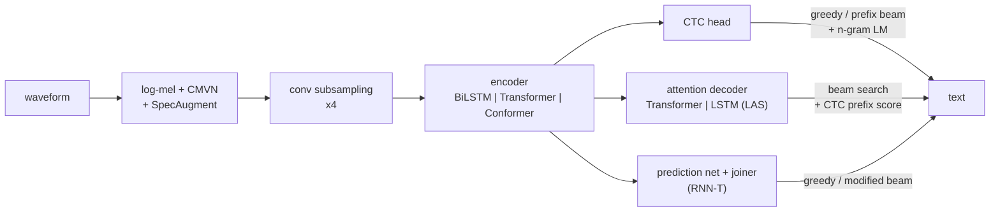

# stt-workbench

**Speech-to-text (ASR) in PyTorch, built to understand how each approach works: CTC,
attention encoder-decoder, Listen-Attend-Spell, hybrid CTC/attention, RNN-Transducer, and
wav2vec2 / Whisper fine-tuning, on BiLSTM, Transformer or Conformer encoders, with every
decoding algorithm, WER/CER evaluation and a Kaggle/Colab notebook.**

[](LICENSE)
[](pyproject.toml)
[](https://pytorch.org)
[](docs/testing.md)
[](docs/inference.md#onnx-export-stt-export)

Every main way of turning speech into text, in one small, readable code base where the
pieces plug into each other. The models are small by default (1–4 M parameters): the point
is to watch each mechanism learn and to compare them on equal footing, on a CPU for the
toy data and on a free GPU for real data.



| approach | `--model` | how the audio frames and the tokens are aligned | code |
|---|---|---|---|
| CTC | `ctc` | blank symbol, sum over all collapsing frame paths | `models.CTCModel` |
| attention encoder-decoder | `aed` | soft alignment learned by cross-attention, Transformer decoder | `models.AttentionModel` |
| Listen, Attend and Spell | `las` | LSTM decoder with location-aware attention | `models.LASDecoder` |
| hybrid CTC/attention | `hybrid` | joint loss, joint decoding with the CTC prefix score | `models.AttentionModel` + `decoding.CTCPrefixScorer` |
| RNN-Transducer | `rnnt` | monotonic lattice with a prediction network (no independence assumption) | `models.TransducerModel` |
| wav2vec2 fine-tuning | notebook | pretrained self-supervised encoder + CTC head | `pretrained.Wav2Vec2Fine` |
| Whisper fine-tuning | notebook | pretrained encoder-decoder, its own tokenizer | `pretrained.WhisperFine` |

Each one is explained with its equations, shapes and trade-offs in
[docs/architecture.md](docs/architecture.md). Decoding (greedy, CTC prefix beam search
with an n-gram LM, attention beam search with CTC rescoring, RNN-T greedy and modified beam
search) is in [docs/inference.md](docs/inference.md).

> **No pretrained weights are published.** The repo trains in minutes on its built-in
> datasets; real training is meant for the Kaggle/Colab notebook.

## Quick start

```bash
git clone https://github.com/benisalla/stt-workbench && cd stt-workbench
uv venv .venv && VIRTUAL_ENV=.venv uv pip install -e ".[dev,rnnt]"   # or: pip install -e ".[dev,rnnt]"
source .venv/bin/activate

stt-data synthetic                                   # a toy spoken language, written locally (no download)
stt-train --data-dir data/synthetic --sample-rate 8000 --model ctc --encoder conformer \
          --d-model 96 --n-layers 4 --max-steps 1500 --output-dir checkpoints/ctc
stt-transcribe checkpoints/ctc/best.pt data/synthetic/val/val_00000.wav --decode beam
stt-eval data/synthetic/val.jsonl hyps.jsonl        # WER / CER + worst alignments
```

Swap `--model` for `aed`, `las`, `hybrid` or `rnnt`, and `--encoder` for `bilstm` or
`transformer`. `stt-data fsdd --clips-per-utterance 3` (15 MB) and `stt-data yesno` (4.5 MB)
give real 8 kHz recordings; `stt-data librispeech` / `ljspeech` / `commonvoice` prepare the
big ones ([docs/data.md](docs/data.md)).

## Results on simple, low-quality audio

These are short CPU runs whose only purpose is to show that every approach learns and that
the decoders work. They are not benchmarks. Real training belongs on a GPU, in the notebook.

### Synthetic toy language (400 train / 60 val sentences, 8 kHz, noisy; chance CER = 100%)

Conformer encoder, `--d-model 96 --n-layers 4` (0.6–0.9 M parameters), batch 16, 1 500 steps,
greedy decoding, one CPU with two threads.

| model | parameters | val WER | val CER | time |
|---|---|---|---|---|
RESULTS_SYNTHETIC

### FSDD: real spoken digits, 3 per clip, held-out speaker (830 train / 166 val clips)

RESULTS_FSDD

The full numbers, commands and curves are in [docs/evaluation.md](docs/evaluation.md).

## Train for real: Kaggle / Colab notebook

[`notebooks/train_colab_kaggle.ipynb`](notebooks/train_colab_kaggle.ipynb) is generated from
`src/stt` by `notebooks/build_notebook.py`, so it holds exactly the package code. Pick
`MODEL` (any of the seven, including `wav2vec2` and `whisper`) and `ENCODER`, point it at a
dataset (Kaggle input, Google Drive, or `DOWNLOAD_DATASET = "librispeech-train-clean-100"`),
and run. It draws live loss / WER curves, compares greedy, beam and beam + LM decoding,
shows the worst alignments, and saves a `best.pt` that the repo's CLIs load.

## Repository layout

```
src/stt/
  config.py      frozen dataclasses: DataConfig, ModelConfig, TrainConfig
  features.py    log-mel front end (torch.stft), CMVN, SpecAugment
  tokenizer.py   characters or SentencePiece; blank / sos / eos / unk
  encoders.py    conv subsampling, BiLSTM, Transformer, Conformer
  models.py      CTCModel, AttentionModel (aed / las / hybrid), TransducerModel
  decoding.py    every search algorithm
  lm.py          n-gram LM (interpolated absolute discounting)
  metrics.py     WER / CER, alignments, `stt-eval`
  data.py        manifests, dataset, bucketed batching
  datasets.py    synthetic / yesno / fsdd / librispeech / ljspeech / commonvoice, `stt-data`
  train.py       trainer, checkpoints, resume, `stt-train`
  transcribe.py  `stt-transcribe`
  export.py      ONNX export of the encoder + CTC head, `stt-export`
  pretrained.py  wav2vec2 and Whisper fine-tuning wrappers
docs/            architecture, data, training, inference, evaluation, testing
tests/           80 tests, ~10 s on a CPU
notebooks/       build_notebook.py -> train_colab_kaggle.ipynb
```

## Documentation

- [docs/architecture.md](docs/architecture.md): every approach, its equations and when to use it
- [docs/data.md](docs/data.md): manifests, built-in datasets, tokenizers, batching
- [docs/training.md](docs/training.md): the training loop, sizes, precision, session limits
- [docs/inference.md](docs/inference.md): the decoding algorithms, LM fusion, ONNX
- [docs/evaluation.md](docs/evaluation.md): WER/CER, the runs behind the results above
- [docs/testing.md](docs/testing.md): what the tests check

## References

Graves et al. 2006 (CTC) · Graves 2012 (RNN-T) · Chan et al. 2016 (LAS) · Chorowski et al.
2015 (location-aware attention) · Watanabe et al. 2017 (hybrid CTC/attention) · Hannun et
al. 2014 (prefix beam search) · Gulati et al. 2020 (Conformer) · Park et al. 2019
(SpecAugment) · Baevski et al. 2020 (wav2vec 2.0) · Radford et al. 2022 (Whisper).

## License

MIT
