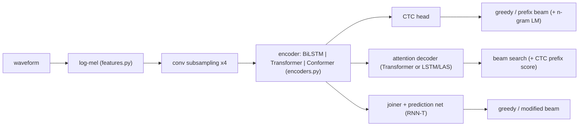

# Architecture: every approach, and why it exists

Automatic speech recognition (ASR) maps a sequence of acoustic frames `x_1..x_T` (hundreds
per second) to a much shorter sequence of tokens `y_1..y_U` (characters or sub-words). The
whole field is about **how to align the two**, because nothing in the data says which
frames belong to which letter. Each approach in this repo is one answer to that question.



The code is organised so that any encoder works with any approach:

| file | holds |
|---|---|
| `features.py` | waveform → log-mel, CMVN, SpecAugment |
| `tokenizer.py` | characters (default) or SentencePiece pieces; special ids |
| `encoders.py` | conv subsampling, BiLSTM, Transformer, Conformer |
| `models.py` | `CTCModel`, `AttentionModel` (aed / las / hybrid), `TransducerModel` |
| `decoding.py` | all the search algorithms |
| `lm.py` | n-gram language model for the beam searches |
| `pretrained.py` | wav2vec2 and Whisper fine-tuning wrappers |

Default sizes are small on purpose (1–4 M parameters, `config.py`): the goal is to see
each mechanism learn, on a laptop CPU for the toy data and on a free GPU for real data.

## 1. Features (`features.py`)

25 ms Hann windows every 10 ms → STFT → power → 80 triangular mel filters → log → CMVN.
The mel scale, `mel(f) = 2595 log10(1 + f/700)`, spends more bins on low frequencies,
where vowel formants are. Per-utterance mean/variance normalisation (CMVN) removes the
recording level. SpecAugment zeroes a few random frequency bands and time spans during
training; the model must then use context, which is the cheapest regulariser in ASR.

Shapes: waveform `(T,)` → features `(T/hop + 1, 80)`.

## 2. Encoders (`encoders.py`)

All encoders begin with **Conv2dSubsampling**: two 3×3 stride-2 convolutions over the
(time, mel) image, i.e. 4× fewer frames (40 ms each). Attention cost is quadratic in the
number of frames, and 10 ms frames carry no extra information for the output.

- **BiLSTM** (Graves 2013, Deep Speech 2): stacked bidirectional LSTMs. Simple and strong
  on small data; sequential, so slow on long inputs.
- **Transformer** (Vaswani 2017; Speech-Transformer): pre-norm self-attention blocks with
  sinusoidal positions. Every frame can look at every other frame.
- **Conformer** (Gulati 2020): a Transformer block sandwiched between two half feed-forward
  layers ("macaron"), plus a depthwise-convolution module for local patterns and relative
  position biases in the attention. Best accuracy per parameter in modern ASR.

Contract: `encoder(feats, lengths) -> (out (B, T', d_model), out_lengths)`. Lengths matter
because batches are padded; every mask in the code comes from them.

## 3. CTC (`CTCModel`)

Connectionist Temporal Classification (Graves 2006). The encoder gives, per frame, a
distribution over the vocabulary plus a **blank** symbol. A frame path `π` of length `T'`
collapses to a label sequence by merging repeats then removing blanks:
`B(h h ∅ e l ∅ l o) = hello`. The loss is the negative log of the sum over *all* paths
that collapse to the transcript:

```
p(y | x) = Σ_{π : B(π) = y} Π_t p(π_t | x)        loss = -log p(y | x)
```

computed by a forward dynamic programme over a `2U+1` state lattice (`nn.CTCLoss`).
Assumption: frames are conditionally independent given the audio. Consequences:

- no implicit language model (every frame decides alone) → beam search with an external
  n-gram LM helps a lot;
- outputs are monotonic and `T' ≥ U` is required (that is why the subsampling is only 4×);
- fastest to train and decode; fully parallel; the usual first baseline.

## 4. Attention encoder-decoder (`AttentionModel`, `aed`)

"Listen, Attend and Spell" (Chan 2016) and its Transformer version. A decoder generates
tokens one at a time, conditioned on all previous tokens and on a context vector it
computes by attending to the encoder output:

```
p(y | x) = Π_i p(y_i | y_<i, x)        c_i = Σ_t softmax_t(score(s_i, h_t)) h_t
```

Training uses teacher forcing: the gold prefix `<sos> y_1..y_{i-1}` is fed and the
cross-entropy of `y_i` is minimised, with label smoothing. Decoding is a beam search over
prefixes until `<eos>`. The decoder is a language model and an aligner in one, which gives
the lowest error with enough data, but the alignment is unconstrained: with little data it
can repeat or skip words, and nothing says it must move left-to-right.

### `las`: LSTM decoder with location-aware attention

The original LAS uses an LSTM and *additive* attention. Location-aware attention (Chorowski
2015) adds a convolution over the previous attention weights to the score:

```
e_{i,t} = wᵀ tanh(W s_i + V h_t + U (F ∗ a_{i-1})_t + b)
```

so the model knows where it looked last and tends to move forward. It is in this repo as
a separate decoder (`LASDecoder`) to compare with the Transformer decoder on equal footing.

## 5. Hybrid CTC/attention (`AttentionModel`, `hybrid`)

Watanabe et al. 2017. The CTC head and the attention decoder share the encoder:

```
loss = λ · L_CTC + (1 - λ) · L_att          (λ = ctc_weight, 0.3 by default)
```

The CTC term forces the encoder to produce a monotonic alignment, which makes the attention
decoder converge faster and behave. At decoding, the attention beam search adds the **CTC
prefix score** of each extension (`decoding.CTCPrefixScorer`): the probability that the CTC
output *starts with* the prefix. Extensions that skip or loop become very unlikely under
CTC and are pruned. The combination is the default in ESPnet and usually the best accuracy
of the three "from the training set only" approaches.

## 6. RNN-Transducer (`TransducerModel`, `rnnt`)

Graves 2012. Like CTC it has a blank and a monotonic lattice, but it removes the
conditional-independence assumption with a **prediction network** `g_u`, an LSTM over the
previous *output* tokens, and a **joiner**:

```
z_{t,u} = softmax(W_o tanh(W_e h_t + W_p g_u))
```

At each lattice node `(t, u)` the model either emits token `y_{u+1}` (move up) or blank
(move right to the next frame). The loss is the sum over all monotonic paths through the
`T' × (U+1)` lattice (`torchaudio.functional.rnnt_loss`). The joiner output is a
`(B, T', U+1, V)` tensor, which is why RNN-T is memory-hungry. It needs no future context
and no attention over the input, so it is the standard for streaming / on-device ASR.

Decoding: greedy (emit until blank at each frame) or a "modified" beam search that allows
at most one symbol per frame and merges hypotheses with the same text.

## 7. Pretrained models (`pretrained.py`)

Everything above learns acoustics from the training transcripts alone, which takes
hundreds of hours of speech to reach good accuracy. Two ways to skip that:

- **wav2vec2 + CTC** (Baevski 2020): a self-supervised encoder pretrained on unlabelled
  audio; fine-tuning puts a CTC head over characters on top. Same loss as `CTCModel`, much
  better encoder. The convolutional front end stays frozen.
- **Whisper** (Radford 2022): an attention encoder-decoder trained on 680 k hours; fine-tuning
  continues its cross-entropy training on your transcripts, with its own tokenizer.

They are thin wrappers (`Wav2Vec2Fine`, `WhisperFine`) with the same `forward -> {"loss"}`
and `transcribe` interface, meant for the Kaggle/Colab notebook.

## 8. Which one when

| need | choose |
|---|---|
| a baseline in minutes, long audio, simple deployment | CTC (+ n-gram LM) |
| best accuracy with enough data, no streaming | hybrid CTC/attention (or aed) |
| streaming / on-device | RNN-T |
| little labelled data | wav2vec2 or Whisper fine-tuning |
| to understand attention alignment visually | las (its attention weights are explicit) |

## Parameter counts (defaults, 32-token vocabulary)

| | BiLSTM | Transformer | Conformer |
|---|---|---|---|
| ctc | 0.98 M | 1.73 M | 3.14 M |
| aed | 1.65 M | 2.41 M | 3.81 M |
| las | 1.28 M | 2.03 M | 3.44 M |
| hybrid | 1.66 M | 2.41 M | 3.82 M |
| rnnt | 1.15 M | 1.90 M | 3.31 M |
