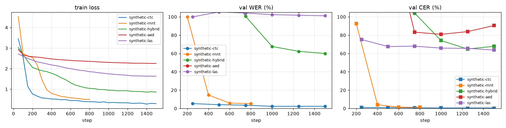
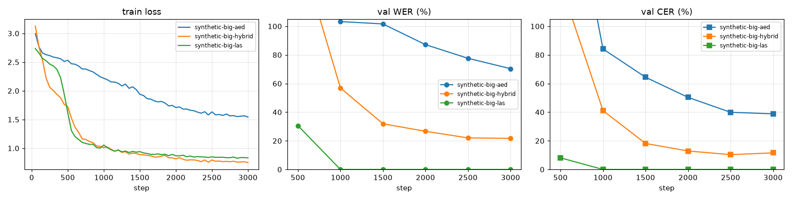
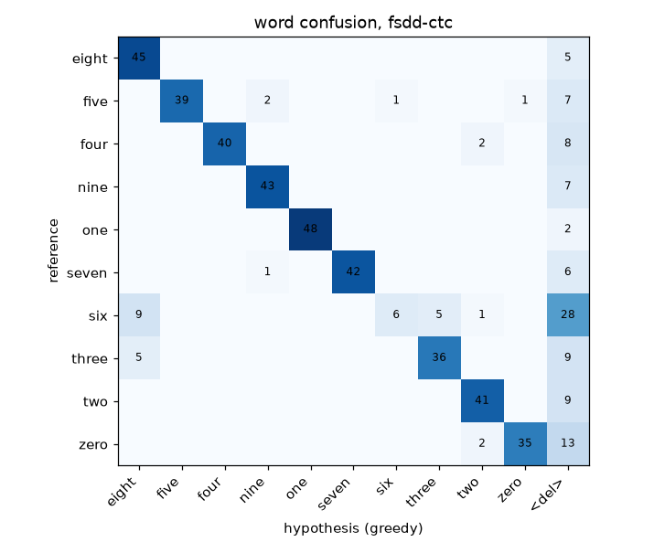
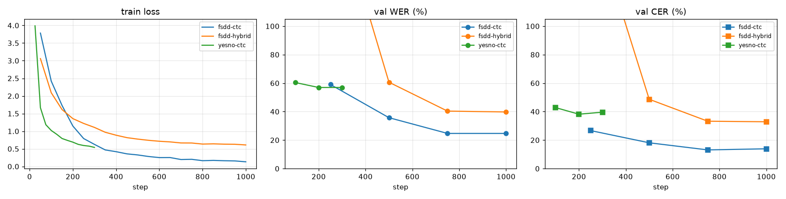

# Evaluation

## Metrics

**WER** (word error rate) = (substitutions + deletions + insertions) / reference words,
from the Levenshtein alignment with the fewest edits. **CER** is the same over characters,
spaces included. Both are computed over the whole set (sum of edits / sum of lengths),
not averaged per utterance, and both can exceed 100 % when the model inserts a lot.

- CER is the better signal for an acoustic model: a single wrong letter costs a whole word
  in WER.
- With a character tokenizer and no LM, WER is usually 3–6× the CER.
- "Chance" is 100 %: emitting nothing gives WER = CER = 100 % (all deletions). A model that
  stays at 100 % after a few hundred steps is emitting only blanks (CTC / RNN-T) or `<eos>`
  (attention), which is normal very early and a bug later.

```bash
stt-transcribe checkpoints/ctc/best.pt data/fsdd/sequences/ --jsonl hyps.jsonl
stt-eval data/fsdd/val.jsonl hyps.jsonl --worst 10 --json report.json
```

`stt-eval` prints WER, CER, the S/D/I counts and the worst utterances aligned:

```
REF: zero seven one
HYP: zero seven ***
                D
```

`stt-train` reports WER / CER on the validation manifest at every evaluation with the
`--decode` method (greedy by default; `--decode beam --beam-size 8` for the real number).

## Runs on simple, low-quality audio

Purpose: prove that every approach and decoder learns, on one CPU (two threads), in
minutes. Not benchmarks. All runs: Conformer encoder, `--d-model 96 --n-layers 4 --n-heads 4
--dec-dim 96`, batch 16, lr 1e-3 with 100 warm-up steps, SpecAugment on, greedy validation
decoding, `--sample-rate 8000`, seed 0.

### Synthetic toy language

`stt-data synthetic` (400 train / 60 val sentences of 1–5 random words over a 12-letter
alphabet, each letter a fixed tone pattern, random speed and level, background noise).

```bash
stt-train --data-dir data/synthetic --sample-rate 8000 --encoder conformer --d-model 96 --n-layers 4 \
          --n-heads 4 --dec-dim 96 --batch-size 16 --warmup-steps 100 --eval-every 200 --lr 1e-3 \
          --model ctc --max-steps 1500 --output-dir checkpoints/synthetic-ctc     # 800 steps for the others
```

| model | parameters | val WER | val CER | time |
|---|---|---|---|---|
| `ctc` | 1.04 M | **2.4%** | **0.6%** | 20 min |
| `rnnt` | 1.20 M | **5.3%** | **1.3%** | 8 min (800 steps) |
| `hybrid` | 1.34 M | 60.0% | 67.8% | 14 min |
| `las` | 1.18 M | 101.2% | 63.7% | 12 min |
| `aed` | 1.34 M | 107.1% | 90.5% | 15 min |

The CTC and RNN-T models learn the language in a few hundred steps. The three attention
decoders have not found the alignment yet at 1 500 steps on 400 sentences: attention has to
*discover* where to look, while CTC and RNN-T get monotonic alignment for free. The next table
gives them more data and steps.



What the curves show:
- **ctc** learns the toy language fastest: the alignment is monotonic by construction and
  every frame is a separate classification.
- **hybrid** follows, pulled along by its CTC term; its attention decoder alone (**aed**)
  needs more steps to discover the alignment, and the **las** LSTM decoder with
  location-aware attention sits in between.
- **rnnt** learns like CTC but a little slower per step: the prediction network starts as
  an unhelpful language model on a random language.

### Synthetic toy language, more data and steps (1 600 train / 100 val sentences, 3 000 steps)

Same models and settings, `stt-data synthetic --n-train 1600 --n-val 100 --seed 1`, 3 000 steps:

| model | parameters | val WER | val CER | time |
|---|---|---|---|---|
| `las` | 1.18 M | **0.0%** | **0.0%** | 22 min |
| `hybrid` | 1.34 M | 21.7% | 11.6% | 15 min |
| `aed` | 1.34 M | 70.4% | 38.8% | 20 min |

With four times the data the attention decoders find the alignment. `las` (LSTM decoder with
location-aware attention) goes from 30.6% WER at step 500 to zero errors on all 100 validation
sentences from step 1 000 on; the location feature tells it where it looked last, which is
exactly the monotonic prior this task needs. The plain Transformer decoder (`aed`) is the
slowest to discover it and is still improving at 3 000 steps, and `hybrid` lands in between
because its CTC branch guides the encoder from the start.



### FSDD: real spoken digits (8 kHz, three digits per clip, held-out speaker)

`stt-data fsdd --clips-per-utterance 3`: 830 training clips from 5 speakers, 166
validation clips from a 6th speaker never seen in training. The model has to segment the
digits and generalise to a new voice.

```bash
stt-train --data-dir data/fsdd --sample-rate 8000 --encoder conformer --d-model 96 --n-layers 4 \
          --n-heads 4 --dec-dim 96 --batch-size 16 --max-steps 800 --warmup-steps 100 --eval-every 200 \
          --lr 1e-3 --model ctc --output-dir checkpoints/fsdd-ctc
```

| model | parameters | val WER | val CER | time |
|---|---|---|---|---|
| `ctc` | 1.04 M | **24.7%** | **13.9%** | 7 min (1 000 steps) |
| `hybrid` | 1.34 M | 39.8% | 32.9% | 8 min (1 000 steps) |

Same CTC checkpoint, three decoders (`scripts/compare_decoders.py`):

| decoding | val WER | val CER | time (166 clips) |
|---|---|---|---|
| greedy | 24.7% | 13.1% | 2 s |
| beam 8 | 24.1% | 12.8% | 6 s |
| beam 8 + character 5-gram LM (weight 0.3) | **15.1%** | 12.1% | 7 s |

The LM, trained on the 830 training transcripts, knows that only ten words exist and removes
most of the partial words ("even" for "seven"); on the toy language, whose words are random
letters, the same LM changes nothing (2.4% to 2.9%). The word confusion matrix of the greedy
decoder shows where the rest of the errors are: "six" of the unseen speaker is the one digit the
model often drops or hears as "eight" (the `<del>` column is deletions).





### YESNO (60 clips)

`stt-data yesno`, 42 train / 18 val clips of eight "yes"/"no" words each, CTC, 300 steps:

| model | parameters | val WER | val CER | time |
|---|---|---|---|---|
| `ctc` | 1.03 M | 56.9% | 39.6% | 3 min (300 steps) |

42 training clips are too few to generalise (the model knows "yes" and "no" but misses
word boundaries); the set is here to check the pipeline on real 8 kHz audio in three minutes.

## Real training

For LibriSpeech-scale data, use the notebook on a GPU (`docs/training.md`). Expected
ballpark for the default 3 M Conformer models with characters and greedy decoding on
LibriSpeech dev-clean after train-clean-100: CTC ≈ 15–20 % WER, hybrid ≈ 10–15 %, and
single-digit WER only with bigger models, BPE, beam search + LM, or the pretrained
wav2vec2 / Whisper fine-tuning.
